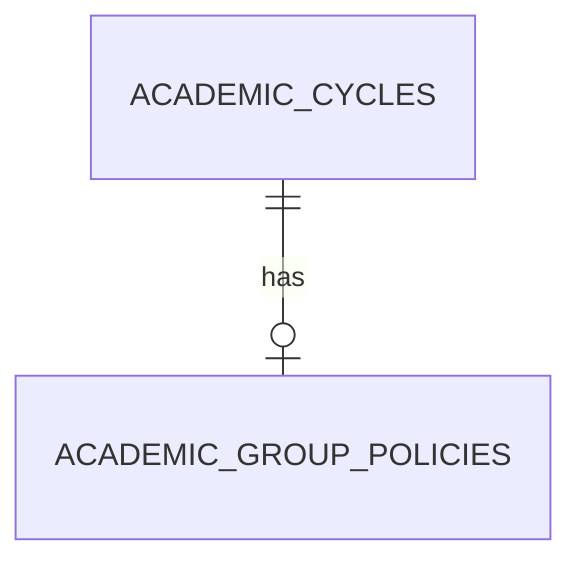

# Academic Configuration

`AcademicCycle` stores a normalized unique code, display name, registration-open flag, and timestamps. `AcademicGroupPolicy` has one policy per cycle and a positive `max_group_size`; the creator counts in that limit.



Read-only API: `GET /api/v1/academic-cycles` returns the configured cycle list. `GET /api/v1/academic-cycles/{id}/group-policy` returns 404 for an unknown cycle and separately 404 when a known cycle lacks a policy. Admin write access awaits authentication.

## Local development bootstrap

The approved local development configuration was created with `scripts/configure_p1_cycle.py`:

- cycle ID: `79`
- code: `FALL-2026`
- display name: `Fall 2026`
- registration open: `true`
- maximum group size: `3`, including the creator

Run it from the project root using:

```powershell
& '.\backend\.venv\Scripts\python.exe' .\scripts\configure_p1_cycle.py
```

The script confirms the target database is `fyphub_p1`, creates the cycle and policy together when absent, and is idempotent. It refuses to overwrite a pre-existing `FALL-2026` cycle or policy with different approved settings. It does not change unrelated cycles, users, teams, or members, and it is not a replacement for future authenticated Admin configuration.

Rollback-isolated verification also covered empty cycles, unknown cycle, missing policy, and a policy response. The read-only cycle and policy APIs were verified after the local bootstrap. Remaining work: authenticated Admin configuration and frontend integration with team registration.
