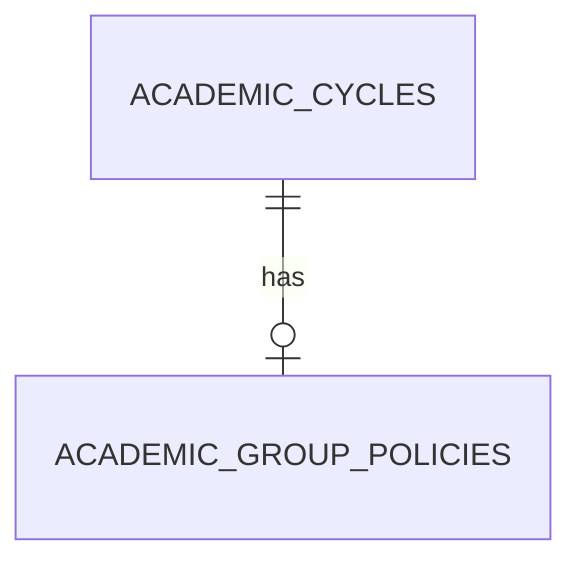

# Academic Configuration

`AcademicCycle` stores a normalized unique code, display name, registration-open flag, and timestamps. `AcademicGroupPolicy` has one policy per cycle and a positive `max_group_size`; the creator counts in that limit.

Read-only API: `GET /api/v1/academic-cycles` returns an empty list when no cycles exist. `GET /api/v1/academic-cycles/{id}/group-policy` returns 404 for an unknown cycle and separately 404 when a known cycle lacks a policy. Admin write access awaits authentication.

Rollback-isolated verification covered empty cycles, unknown cycle, missing policy, and a policy response. No real cycle or policy was created. Remaining work: authenticated Admin configuration and atomic team registration.
