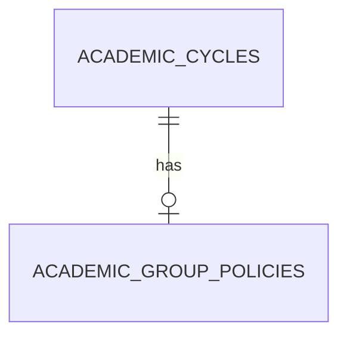

# Academic Configuration

`AcademicCycle` stores a normalized unique code, display name, registration-open flag, and timestamps. `AcademicGroupPolicy` has one policy per cycle and a positive `max_group_size`; the creator counts in that limit.



Read-only API: `GET /api/v1/academic-cycles` returns the configured cycle list. `GET /api/v1/academic-cycles/{id}/group-policy` returns 404 for an unknown cycle and separately 404 when a known cycle lacks a policy. Admin write access awaits authentication.

## Local development bootstrap

The approved local development configuration was created with `scripts/configure_p1_cycle.py`:

- cycle ID: `79`
- code: `FALL-2026`
- display name: `Fall 2026`
- registration open: `true`
- maximum group size: `3`, including the creator

Run it from the project root using:

```powershell
& '.\backend\.venv\Scripts\python.exe' .\scripts\configure_p1_cycle.py
```

The script confirms the target database is `fyphub_p1`, creates the cycle and policy together when absent, and is idempotent. It refuses to overwrite a pre-existing `FALL-2026` cycle or policy with different approved settings. It does not change unrelated cycles, users, teams, or members, and it is not a replacement for future authenticated Admin configuration.

Rollback-isolated verification also covered empty cycles, unknown cycle, missing policy, and a policy response. M1-C.1 now provides ADMIN-only cycle creation, updates, registration opening/closure, and policy create/update. New cycles are closed; opening requires a positive policy, and policy reductions below an active team size are rejected. Management locks the cycle then policy in the same order as team registration and appends a safe academic audit target atomically. Semester management and unspecified workflow policies remain unimplemented.

The Admin screen loads each cycle's current policy and shows its maximum including the creator, or `Not configured` when absent. Editing exposes the existing code, display name, and policy value; backend conflict messages remain visible beside the screen state.

## Concurrent registration/configuration verification

`backend/tests/test_cycle_concurrency.py` uses independently committed, uniquely named temporary fixtures and separate SQLAlchemy sessions. A controlled `TeamMember` insert barrier holds a real registration only after it has locked the cycle and policy; all waits have a five-second bound.

- A registration racing a closure commits its complete account, team, and two members first. The closure transaction then obtains the same cycle-then-policy locks and commits the closed state; no partial team records are left.
- A registration racing a reduction to one waits in the same way. Once registration commits, the production policy operation sees the two-member active team and returns `409 existing_team_exceeds_limit`; the policy remains unchanged and no audit event is written for the rejected operation.

The closure test uses the production `locked_cycle_and_policy` helper rather than the audited HTTP handler so its temporary committed fixture can be removed without bypassing the append-only audit trigger. Existing endpoint tests separately cover successful academic audit writes. The concurrency fixtures remove only their own committed rows in `finally` cleanup and do not modify `FALL-2026` or existing accounts.
