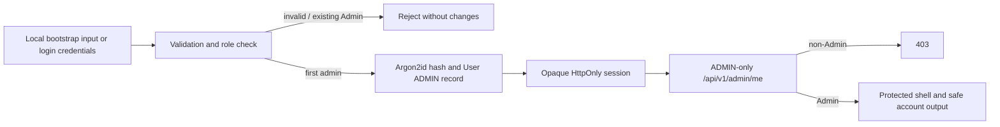

# Admin portal (M1-A)

## Implemented boundary

The portal shell is available only after an authenticated `ADMIN` account successfully calls `GET /api/v1/admin/me`. It presents a responsive full-width application shell with a 240px desktop sidebar, a mobile menu, compact verified account/logout controls, and no placeholder counts, fake charts, or management controls.

The Overview reads the existing public academic-cycle and group-policy APIs with credentialed requests. It displays only actual cycles, their registration state, and their configured group-size policy. Loading, empty, missing-policy, and request-failure states are explicit. Other M1 navigation items are visibly disabled until their authorized APIs and screens exist, except the implemented Supervisor Capacity destination.

## Supervisor Capacity

The ADMIN-only **Supervisor Capacity** screen fetches active persisted SUPERVISOR accounts, academic cycles, and stored capacity policies. It creates or edits one positive whole-number maximum per supervisor/cycle, shows saved values, labels a policy as historical if its supervisor has since become ineligible, and handles loading, empty, error, and save feedback. User screenshots verify successful creation and edit-form population, including separate supervisor-name selection and read-only supervisor-email display. Update-save, post-save refresh persistence, and mobile browser verification remain pending. It does not allocate supervisors to teams or display filled/remaining counts.

The public login screen includes an Administrator role card. Selecting it does not create or elevate an account: login sends `requested_role: "ADMIN"`, and the backend compares it to the persisted role. Public signup routes Administrator selection to the existing restricted-registration message.

## First-admin bootstrap

Run locally, only after reviewing the target database:

```powershell
& '.\backend\.venv\Scripts\python.exe' .\scripts\bootstrap_first_admin.py
```

The helper prompts for name, email, and password through `getpass`; it does not display credentials. It refuses any database except `fyphub_p1`, refuses to run if any ADMIN already exists, and refuses an email already owned by another account. It never promotes, overwrites, or deactivates an account. Do not run it in unattended automation.

## M1-A pipeline



## M1-B users and roles

`GET /api/v1/admin/users` supports ADMIN-only pagination, search, role, and active-status filters. `POST /api/v1/admin/users` creates a validated account using the existing Argon2id utility and assigns its initial role. Existing roles are fixed: `PATCH /api/v1/admin/users/{id}/role` returns `assigned_role_locked` without mutation. Status changes remain available through `/status`. All mutations validate browser Origin, require a persisted ADMIN session, return safe account data, and never expose password hashes or session data.

Every successful account creation, role change, or status change writes an `admin_audit_events` row in the same database transaction. It records actor, affected account, action, timestamp, and safe metadata only. Migration `b8d2e4f6a9c1` adds a PostgreSQL trigger which rejects ordinary `UPDATE` and `DELETE` against that table. Database owners or privileged maintenance operations can still alter/drop that protection; it is not an immutable external ledger.

Changing a role or deactivating an account revokes its live sessions. The current implementation rejects both role changes and deactivation for shared-team login accounts to avoid invalidating their team relationship. **Whether shared-team deactivation should instead be allowed with a defined team-lifecycle policy remains an unresolved product-policy decision; this restriction is implementation safety, not proposal-approved policy.** A PostgreSQL transaction advisory lock serializes changes that could remove the final active ADMIN.

Pipeline: authenticated ADMIN → input/relationship validation → locked account mutation and session revocation → safe append-only audit event → one commit → refreshed UI list. The screen has real loading, empty, failure, field-error, confirmation, and duplicate-submit states. Browser verification remains pending.

## Limits

M1-C.1 provides an ADMIN Academic Cycles & Policies destination. New cycles remain closed until a positive group-size policy is set; broader semester and workflow management are not implemented. Separate-connection backend tests hold an in-flight registration at its member insert, then verify closure waits for its commit and an invalid reduction rejects after observing the committed team. Browser verification remains pending.

- M1-B account management is implemented, but audit-history viewing, academic policy mutation, templates, capacities, evaluation criteria, deadlines, and reminders are not implemented yet.
- This checkpoint creates no first Admin automatically and does not claim browser testing until a local Admin is deliberately provisioned.
- The current database model has no audit table. Audit logging begins with the first M1 mutation checkpoint, before any management mutation endpoint is added.
- Manual responsive visual verification remains pending; restart the Vite development server after pulling this UI change if it is already running so Tailwind reloads the extracted component classes.
