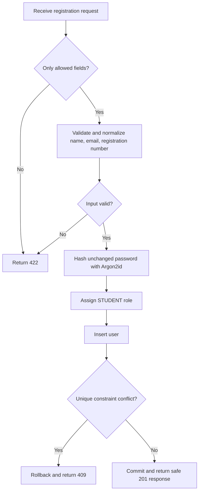

# Authentication Foundation

## Checkpoint 7A: browser sessions

`POST /api/v1/auth/login` accepts strict JSON containing only `email` and `password`. Email is trimmed and lowercased; the password is used exactly as supplied. It verifies the existing Argon2id hash and active-account state, returning the same `401 {"detail":"Invalid credentials."}` for unknown, incorrect, and inactive credentials. Unknown accounts run an Argon2id dummy verification. Login never creates accounts or changes passwords.

The login contract now accepts exactly one account identifier: `email` or the linked account creator's `registration_number`; member contact emails are never login identifiers. Existing email/password clients remain valid. A client may additionally send `requested_role` (`STUDENT`, `SUPERVISOR`, `PANEL_MEMBER`, or `COORDINATOR`); authentication fails with the same generic `401` unless it matches the database role. Role selection therefore cannot grant a privilege. `ADMIN` remains supported by the backend but is not exposed as a public role-selection card.

A successful login returns safe user fields (`id`, `full_name`, `email`, `registration_number`, `role`, and `is_active`) and sets an opaque `fyphub_session` cookie. The database stores only its SHA-256 hash with its user foreign key, timezone-aware `created_at`/`expires_at`, and nullable `revoked_at`; it never stores or returns the raw token. Sessions last **8 hours**. A successful login revokes any presented session before issuing a new one.

`GET /api/v1/auth/me` authenticates that cookie and returns the same safe fields. Missing, tampered, expired, revoked, or deactivated-account sessions return `401`. `POST /api/v1/auth/logout` revokes the presented session where applicable and clears the cookie; it returns `204` even when no usable session exists.

Cookie settings are `HttpOnly`, `SameSite=Lax`, `Path=/`, and omit `Domain`. `Secure` is enabled except for HTTP requests to `127.0.0.1`, the explicit local-development exception. Browser session values are not used in local/session storage. Passwords, raw tokens, and cookie values are never logged.

Credentialed CORS is limited exactly to `http://127.0.0.1:5174`; no wildcard is used. Login and logout reject a supplied `Origin` other than that exact origin. This is the CSRF boundary for state-changing cookie routes: same-site Lax cookies plus explicit Origin validation protect browser form/fetch requests; any future cross-origin deployment must replace both configured origin and its CSRF design together.

```mermaid
flowchart LR
    A[Strict login JSON] --> B[Normalize email / verify Argon2id]
    B --> C[Revoke presented session]
    C --> D[Generate opaque token]
    D --> E[Persist token hash + 8h expiry]
    E --> F[HttpOnly cookie + safe user]
    F --> G[/me validates hash, expiry, revocation, active user]
    F --> H[/logout revokes and clears cookie]
```

Reusable `get_current_user` and `require_roles(...)` dependencies enforce active sessions and role authorization for later protected APIs. No privileged account creation or placeholder business API was added.

## Authentication test repair (Checkpoint 7A follow-up)

The rollback-isolated authentication fixture now captures its user ID and registration number before its setup session closes, rather than dereferencing a detached ORM instance. Its ASGI helper concatenates response body frames and decodes JSON only when the response advertises JSON; CORS preflight plain text and empty `204` bodies are handled correctly. Logout explicitly returns HTTP `204`, preserving its revocation and cookie-clearing behavior. The focused authentication suite passed 6/6 tests and the complete backend suite passed 30/30 tests after this repair.

## Student registration

`POST /api/v1/auth/register` creates a student account only. Public registration cannot assign a role, set account activity, create staff accounts, or issue tokens.

### Request

```json
{
  "full_name": "Student Name",
  "email": "student@example.com",
  "registration_number": "FYP-001",
  "password": "A password between 8 and 128 characters"
}
```

The request accepts only these four fields. Unknown fields, including `role` and `is_active`, are rejected.

### Successful response

Successful registration returns HTTP `201 Created` with safe account fields only:

```json
{
  "id": 1,
  "full_name": "Student Name",
  "email": "student@example.com",
  "registration_number": "FYP-001",
  "role": "STUDENT",
  "is_active": true,
  "created_at": "2026-10-14T00:00:00+00:00"
}
```

Neither `password` nor `password_hash` is returned.

### Status codes

| Status | Meaning |
| --- | --- |
| `201` | Student account registered. |
| `409` | Normalized email or registration number already exists. |
| `422` | Invalid, missing, blank, too-long, too-short, or unaccepted request input. |

## Normalization and password handling

- `full_name` is trimmed and must be 1–255 non-whitespace characters.
- `email` is validated, trimmed, and lowercased; it must fit the 320-character database column.
- `registration_number` is trimmed and uppercased, must be nonblank, and must fit the 100-character database column.
- Passwords are used exactly as supplied: they are never trimmed, lowercased, or otherwise normalized. They must be 8–128 characters.
- Passwords are stored only as Argon2id hashes using `argon2-cffi`; plaintext passwords and hashes are never returned or logged.



## Verification

Database integration tests were run against `fyphub_p1` with a dependency override bound to an outer transaction. The test suite ran six tests and passed all six:

- successful student registration and safe response fields;
- correct and incorrect Argon2id password verification;
- stored password hash verification;
- duplicate normalized email handling;
- duplicate normalized registration-number handling;
- invalid email, missing/blank fields, invalid password lengths, and rejected `role`/`is_active` fields.

The users table contained zero rows before and after the suite, confirming test writes were rolled back. Python compilation and `pip check` also passed.

## Remaining work

Password reset/change workflows, email delivery, controlled staff creation, and role dashboards remain pending. The recovery screen honestly reports that no email delivery service is configured; it does not issue or expose reset tokens.

## Password-entry UI convention

Use the shared `PasswordField` for password-entry forms. Enable its advisory guidance for sign-in; account-creation fields use the same guidance, while confirmation fields show match/mismatch feedback without a strength meter. Guidance does not impose character-category requirements or alter authentication validation. Keep password values unchanged and do not log or persist them in browser storage.
