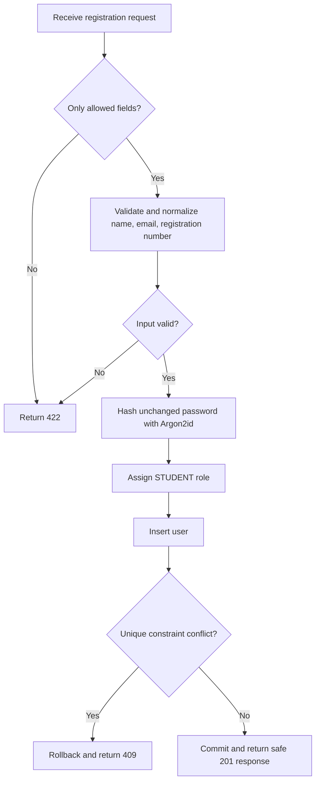

# Authentication Foundation

## Student registration

`POST /api/v1/auth/register` creates a student account only. Public registration cannot assign a role, set account activity, create staff accounts, or issue tokens.

### Request

```json
{
  "full_name": "Student Name",
  "email": "student@example.com",
  "registration_number": "FYP-001",
  "password": "A password between 8 and 128 characters"
}
```

The request accepts only these four fields. Unknown fields, including `role` and `is_active`, are rejected.

### Successful response

Successful registration returns HTTP `201 Created` with safe account fields only:

```json
{
  "id": 1,
  "full_name": "Student Name",
  "email": "student@example.com",
  "registration_number": "FYP-001",
  "role": "STUDENT",
  "is_active": true,
  "created_at": "2026-10-14T00:00:00+00:00"
}
```

Neither `password` nor `password_hash` is returned.

### Status codes

| Status | Meaning |
| --- | --- |
| `201` | Student account registered. |
| `409` | Normalized email or registration number already exists. |
| `422` | Invalid, missing, blank, too-long, too-short, or unaccepted request input. |

## Normalization and password handling

- `full_name` is trimmed and must be 1–255 non-whitespace characters.
- `email` is validated, trimmed, and lowercased; it must fit the 320-character database column.
- `registration_number` is trimmed and uppercased, must be nonblank, and must fit the 100-character database column.
- Passwords are used exactly as supplied: they are never trimmed, lowercased, or otherwise normalized. They must be 8–128 characters.
- Passwords are stored only as Argon2id hashes using `argon2-cffi`; plaintext passwords and hashes are never returned or logged.



## Verification

Database integration tests were run against `fyphub_p1` with a dependency override bound to an outer transaction. The test suite ran six tests and passed all six:

- successful student registration and safe response fields;
- correct and incorrect Argon2id password verification;
- stored password hash verification;
- duplicate normalized email handling;
- duplicate normalized registration-number handling;
- invalid email, missing/blank fields, invalid password lengths, and rejected `role`/`is_active` fields.

The users table contained zero rows before and after the suite, confirming test writes were rolled back. Python compilation and `pip check` also passed.

## Remaining work

Sign-in, sessions or tokens, authorization enforcement, controlled staff creation, password reset/change workflows, and frontend registration screens remain out of scope for this checkpoint.
