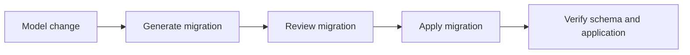

# Database Migrations

## Purpose

Alembic provides the versioned database-migration infrastructure for future FYPHub application models. This checkpoint creates the infrastructure only: there are no application models, revisions, or application tables yet.

## Structure

- `backend/alembic.ini` configures Alembic and points to the migration environment.
- `backend/alembic/env.py` imports the shared SQLAlchemy `Base.metadata` and reuses the application's database engine.
- `backend/alembic/script.py.mako` is the template for future revision files.
- `backend/alembic/versions/` will contain reviewed migration revisions.

Alembic receives connectivity through the existing application configuration. Credentials are not stored in `alembic.ini`; the root ignored `.env` remains the only password source. Both online and offline migration modes are supported.

## Command pattern

Run Alembic from the project root through the project-local virtual environment:

```powershell
& '.\backend\.venv\Scripts\python.exe' -m alembic -c backend/alembic.ini <command>
```

## Future workflow



When a future model change is ready, generate a migration, inspect the generated revision, apply it in the intended environment, and verify both the schema and application behavior. Do not use `metadata.create_all()` as a replacement for reviewed migrations.

## Verified initial state

The initial Alembic checks completed with empty `heads`, `history`, and `current` output. No `alembic_version` table was created during these inspections, and the `public` schema contains no application tables. No revisions were generated or applied.
