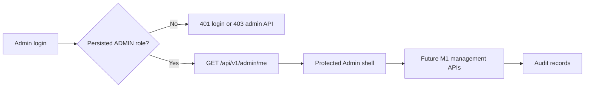

# P1 feature tracker

Status is evidence-based: **Not Started**, **Partial**, **Verified**, or **Blocked**. P1 contains M1 Admin Dashboard & Academic Management, M2 Student Team & Collaboration Hub, and M3 Student Proposal & AI Compliance Check.

| Module / proposal requirement | Backend/API | Database / migration | UI | Permission enforcement | Test evidence | Documentation / diagram | Remaining work | Status |
| --- | --- | --- | --- | --- | --- | --- | --- | --- |
| M1-A Admin access and shell | `GET /api/v1/admin/me`; local first-admin helper | Existing `users.role`; no new schema required | Protected administrator shell, real account/logout controls | Persisted `ADMIN` role required | Admin/non-admin API coverage | `admin-portal.md` | Create an Admin locally before browser testing | Partial |
| M1-B User and role management | ADMIN-only list/create/role/status APIs | `b8d2e4f6a9c1` append-only audit events | Protected Users & Roles screen | ADMIN role, team and last-admin guards | 6 M1-B rollback-isolated tests; full suite | Admin/user-management docs | Browser review, audit-history reader; shared-team deactivation policy decision | Partial |
| M1-C Cycles / group and workflow policy | Read-only cycle/policy APIs; team registration enforces group policy | Existing cycle/policy tables | Not implemented | No Admin mutation API | Existing cycle/team tests | Existing cycle docs | Admin mutations, proposal workflow policy, safe change checks | Partial |
| M1-D Versioned proposal templates / rules | Not implemented | Not implemented | Not implemented | Not implemented | None | None | Official formatting values and storage policy required | Not Started |
| M1-E Supervisor capacity | Not implemented | Not implemented | Not implemented | Not implemented | None | None | Assignment source and reduction rules | Not Started |
| M1-F Rubrics / criteria | Not implemented | Not implemented | Not implemented | Not implemented | None | None | Approved rubric definitions required | Not Started |
| M1-G Academic deadlines | Not implemented | Not implemented | Not implemented | Not implemented | None | None | Official deadline values required | Not Started |
| M1-H Reminders / escalation processing | Not implemented | Not implemented | Not implemented | Not implemented | None | None | Scheduler and delivery configuration required | Not Started |
| M1-I Audit history | Mutation events written atomically | Append-only event table and trigger | Not implemented | Database trigger rejects ordinary UPDATE/DELETE | M1-B trigger coverage | Admin docs | Authorized audit-history reader | Partial |
| M2 Team formation / membership | Shared team registration is implemented | Teams and members schema applied | Shared-team registration form implemented | Student registration only | Existing team tests | Team registration docs | Membership verification, matching, requests, chat/channels | Partial |
| M2 Compatibility, matching, requests, collaboration, group AI | Not implemented | Not implemented | Not implemented | Not implemented | None | None | Shared-login attribution decision required before requests/matching | Not Started |
| M3 Proposal lifecycle / AI compliance | Not implemented | Not implemented | Not implemented | Not implemented | None | None | Templates, formats, lifecycle and checker rules | Not Started |

