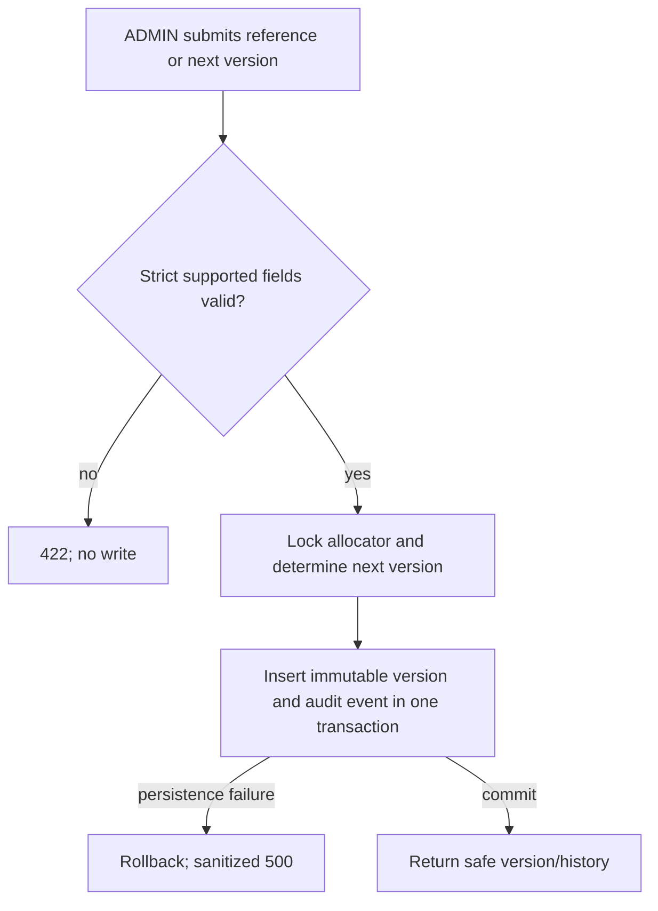
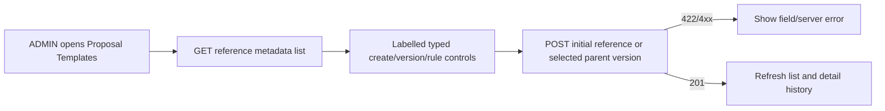
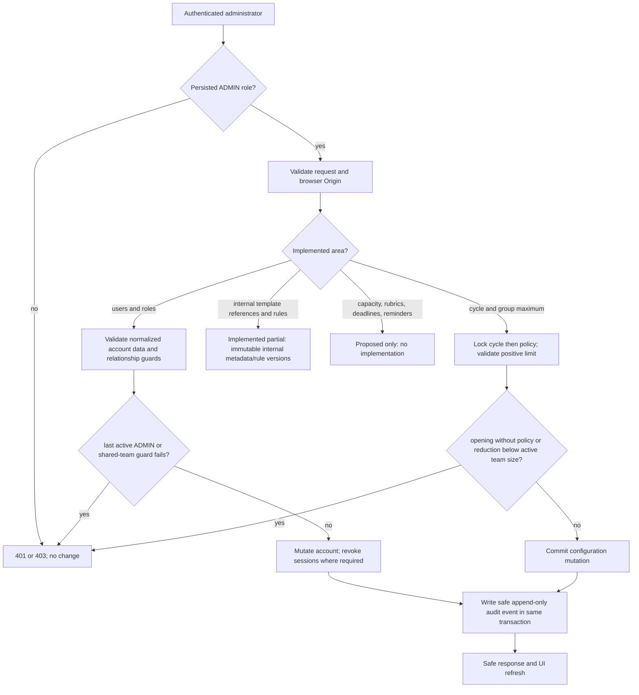
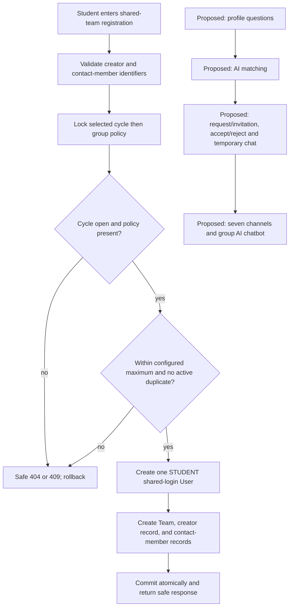
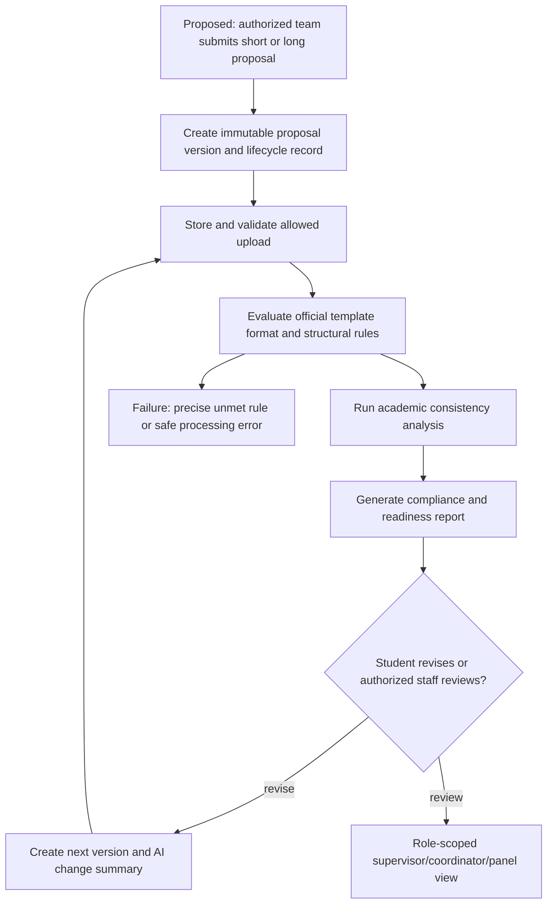

# P1 feature explanations, workflows, and demonstrations

## Implemented M1-D.1 transaction pipeline

This is internal reference management only: no publication, activation, retirement, upload, download, or M3 compliance analysis is implemented.

### M1-D.2 UI-to-API flow

The list response includes the stable server-provided `reference_id`; selecting any listed metadata version retrieves its complete history through the detail endpoint after a fresh page load.

This companion explains the source-cited matrix in [p1-feature-tracker.md](p1-feature-tracker.md). Requirements are from *long proposal.pdf* section 9.3 (PDF pp9-10), P1 timing from section 10 (p14), and five-role shared-module architecture from *short proposal.pdf* (p2). It describes current behaviour; it does not claim planned flows already work.

## Plain-English feature explanation

### M1 - academic governance

M1 is the controlled configuration layer. Administrators should maintain people and roles, academic cycles and group limits, official proposal templates and versioned rules, supervisor capacity, panel scoring configuration, deadlines, reminder/escalation rules, and an audit trail. Today user/role management, limited cycle/group-size configuration, append-only audit writing, and internal template-reference metadata with immutable academic-rule versions are present. The template work is Partial: it has no official files, publication, storage/download, activation/retirement, or compliance checking. Workflow policies, capacity, rubrics, criteria, deadlines, reminders, escalations, and audit-history viewing remain absent.

### M2 - team formation and collaboration

M2 should let students form one legitimate team per cycle, discover compatible teammates through a defined 8-10-question profile, make and answer joining/invitation requests, use temporary match chat, then collaborate in seven named channels with a group chatbot. Current work is narrower: one shared team account can be registered with a creator and contact-member records, subject to cycle opening, maximum group size, and duplicate registration/contact restrictions. It is not a discovery, invitation, chat, channel, or chatbot system.

### M3 - official proposal and readiness record

M3 should hold one official short/long proposal record, uploads and versions, state transitions for draft/submission/resubmission, and readiness analysis. The report must check the university's actual format and structure and assist with consistency analysis; authorized staff view the same analysis according to permission. No M3 implementation exists. Submitted project proposals are requirements evidence, not official blank university templates or numeric formatting rules.

## Actual and proposed pipelines

### M1 pipeline

Actual implementation is in `backend/app/main.py`, backed by `User`, `AcademicCycle`, `AcademicGroupPolicy`, and `AdminAuditEvent`. Proposed-only nodes are intentionally not interactive in the Admin navigation.

### M2 pipeline

The lower proposed branch is not connected to the current shared-account flow. Its design must decide how requests, invitations, chat authorship, and acceptance work without silently changing the approved shared-login model.

### M3 pipeline

This entire M3 pipeline is proposed only. It cannot begin responsibly until M1-D has official templates and versioned academic rules, and the proposal lifecycle is approved.

## Evidence and manual demonstration steps

Automated evidence is listed per feature in the matrix. The following demonstrations use a deliberately provisioned test Admin and test data only; do not alter `FALL-2026`, Team 81, account 122, demo account 6, or real audit history.

1. Start the backend and frontend using existing local configuration. Sign in with an authorized test Admin account.
2. Open **Users & Roles**. Demonstrate search, role/status filters, pagination, valid account creation, and confirmation before a role/status change. Confirm only safe fields are displayed.
3. Open **Academic Cycles & Policies**. With an isolated test cycle, show code/name, registration state, a positive maximum including the creator, and `Not configured` where no policy exists. Show the safe conflict when opening without a policy.
4. With an isolated team, attempt to reduce the maximum below team size. Confirm the conflict and unchanged policy.
5. Log out and verify the authenticated account view is unavailable.

No screenshots were captured in this checkpoint. Browser verification remains pending until these steps are performed and screenshots are deliberately captured.

## Prioritized remaining checkpoints and blockers

### Remaining M1-D decisions: official templates with versioned academic rules

The implemented administrative reference foundation still requires:

- official blank short- and long-proposal files and an approval authority;
- publication/storage/download and activation/retirement policy and operations;
- approved machine-readable normative rules that can later drive M3, but no proposal upload or AI checker yet;
- browser verification of the existing ADMIN screen.

This implements the M1 template/rules foundation without claiming M3 format checking.

### Questions that block M1-D

1. Provide the official blank short-proposal and long-proposal templates, their file format(s), and the authority that approves a new version.
2. Provide the authoritative formatting specification: fonts/sizes, margins, alignment, spacing, headings, numbering, table/figure rules, required sections/order, references, appendices, and captions. The submitted project proposals do not establish these rules.
3. Decide template version policy: activation/retirement authority, historical-submission linkage, effective dates, and whether one version of each type must be active.
4. Decide whether template files live in application/database storage, approved object storage, or a controlled external repository, including retention and download permissions.

### Subsequent source-dependent decisions

- Define semester/workflow states before M1 workflow policy work.
- Provide capacity, rubric/scoring, deadline, reminder, and escalation policies before their M1 checkpoints.
- Resolve shared-login attribution for M2 matching, invitations, requests, chat, and collaboration before building those flows.
- Define M3 lifecycle, upload/storage, role visibility, AI model/grounding/disclosure, and human-review rules before implementation.
