# P1 feature explanations, workflows, and demonstrations

## Implemented M1-D.1 transaction pipeline

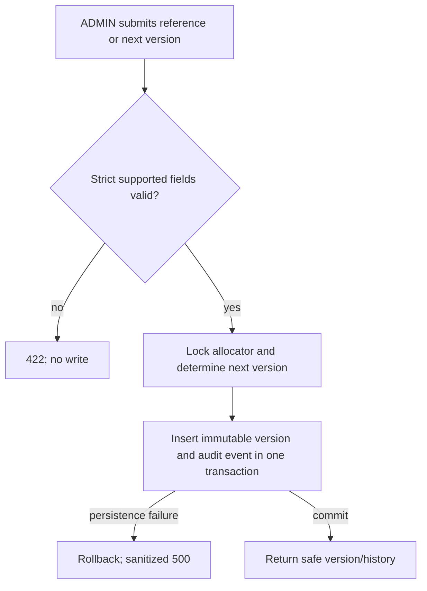

This is internal reference management only: no publication, activation, retirement, upload, download, or M3 compliance analysis is implemented.

### M1-D.2 UI-to-API flow

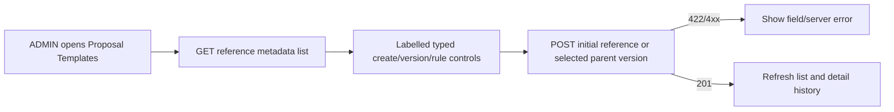

The list response includes the stable server-provided `reference_id`; selecting any listed metadata version retrieves its complete history through the detail endpoint after a fresh page load.

This companion explains the source-cited matrix in [p1-feature-tracker.md](p1-feature-tracker.md). Requirements are from *long proposal.pdf* section 9.3 (PDF pp9-10), P1 timing from section 10 (p14), and five-role shared-module architecture from *short proposal.pdf* (p2). It describes current behaviour; it does not claim planned flows already work.

## Plain-English feature explanation

### M1 - academic governance

M1 is the controlled configuration layer. Administrators should maintain people and roles, academic cycles and group limits, official proposal templates and versioned rules, supervisor capacity, panel scoring configuration, deadlines, reminder/escalation rules, and an audit trail. Today user/role management, limited cycle/group-size configuration, supervisor-capacity configuration, append-only audit writing, internal template-reference metadata with immutable academic-rule versions, internal Evaluation Criteria drafts with immutable ordered criteria, non-operational deadline configuration, non-operational reminder/escalation rule configuration, and an ADMIN-only audit-history viewer are present. Template and Evaluation Criteria work remain Partial: neither provides an approved publication/activation lifecycle, and criteria drafts intentionally contain no academic scoring values. Workflow-policy drafts now record administrator-supplied state and transition labels; publication, execution, deadline enforcement, reminder delivery, and escalation execution remain absent.

### Supervisor allocation

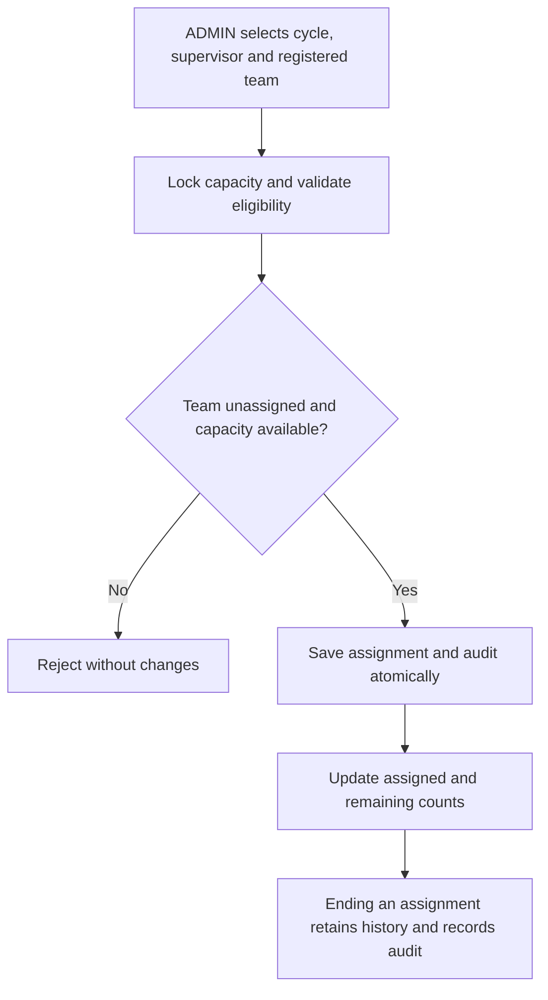

Only active ADMIN users can manage assignments. An active SUPERVISOR and a matching cycle capacity policy are required; one active supervisor assignment per team is allowed. Capacity changes cannot move an in-use policy or reduce it below active assignments. No Coordinator access or department scope is introduced.

### M1-K.1 workflow-policy draft pipeline

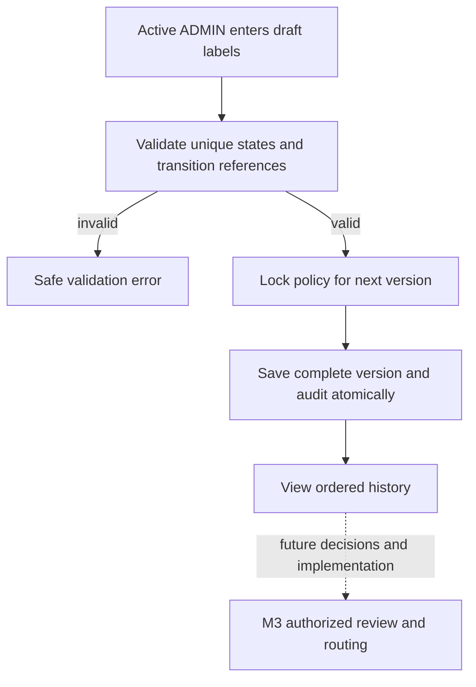

Drafts are configuration only and do not execute transitions or create review authority. Existing proposal-review decisions continue to apply: the assigned Supervisor owns the first academic review, assigned Panel members review defense proposals, and the Coordinator manages routing and oversight subject to authorization and history boundaries. Early-routing initiator, corrections and resubmissions, final approval authority, and Coordinator department/cycle scope remain unresolved. Panel chat is outside scope. Browser and mobile verification remain pending.

### M2 - team formation and collaboration

M2 should let students form one legitimate team per cycle, discover compatible teammates through a defined 8-10-question profile, make and answer joining/invitation requests, use temporary match chat, then collaborate in seven named channels with a group chatbot. Current work is narrower: one shared team account can be registered with a creator and contact-member records, subject to cycle opening, maximum group size, and duplicate registration/contact restrictions. It is not a discovery, invitation, chat, channel, or chatbot system.

### M3 - official proposal and readiness record

M3 should hold one official short/long proposal record, uploads and versions, state transitions for draft/submission/resubmission, and readiness analysis. The report must check the university's actual format and structure and assist with consistency analysis; authorized staff view the same analysis according to permission. No M3 implementation exists. Submitted project proposals are requirements evidence, not official blank university templates or numeric formatting rules.

## Actual and proposed pipelines

### M1 pipeline

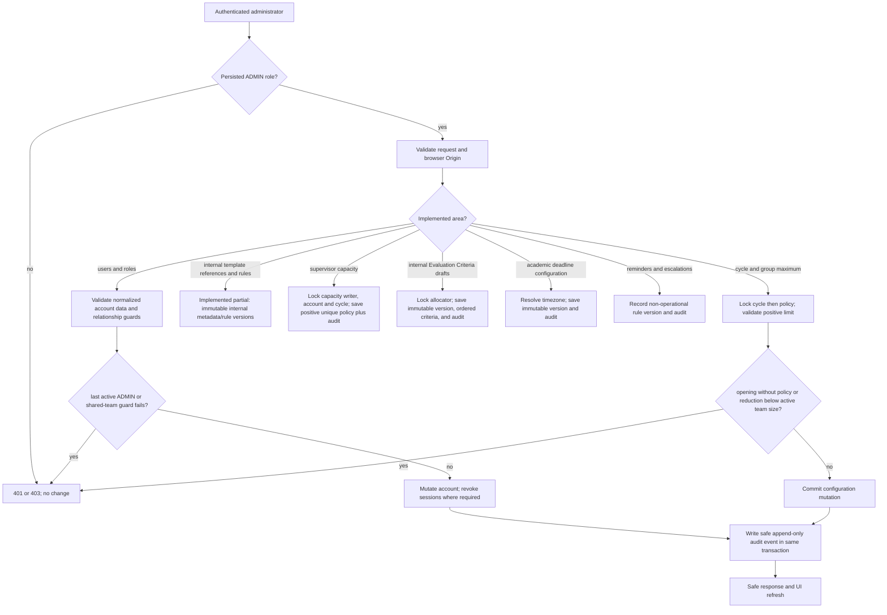

Actual implementation is in `backend/app/main.py`, backed by the account, academic, capacity, Evaluation Criteria-version, and audit models. Proposed-only destinations remain disabled in the Admin navigation.

## M1-I.1 read-only audit history

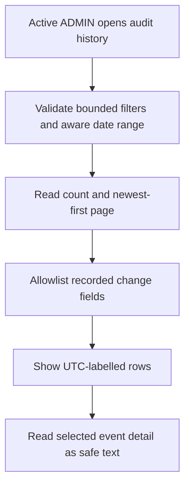

List and detail preserve recorded actor and target IDs even when related display information is unavailable. Unknown legacy change fields are omitted, not inferred. The reader does not modify events or add audit events; existing database append-only protections remain in place. Four focused tests and the full 71-test backend suite pass against the final pagination implementation. Frontend lint/build pass; browser and mobile verification are pending. M1 and P1 remain Partial.

## M1-H.1 reminder and escalation configuration

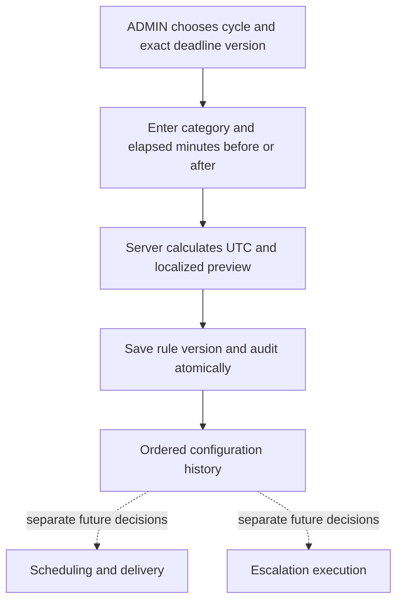

The calculation adds or subtracts elapsed minutes from the exact referenced deadline instant in UTC, then displays the result in its stored IANA zone. This is not a local calendar-day rule. Later deadline versions never silently change an existing reference. Both rule identity and its versions are non-operational configuration; no job or message is created. Scheduling, delivery, recipient eligibility and channels, trigger and submission-status dependencies, stopping conditions, retry policy, and escalation authority and execution require future decisions. Four focused tests and 67 backend tests pass; Alembic current/head/check, pip check and frontend lint/build pass. Browser preview invalidation, save/history and mobile checks remain pending. M1 and P1 remain Partial.

## M1-G.1 academic deadline configuration pipeline

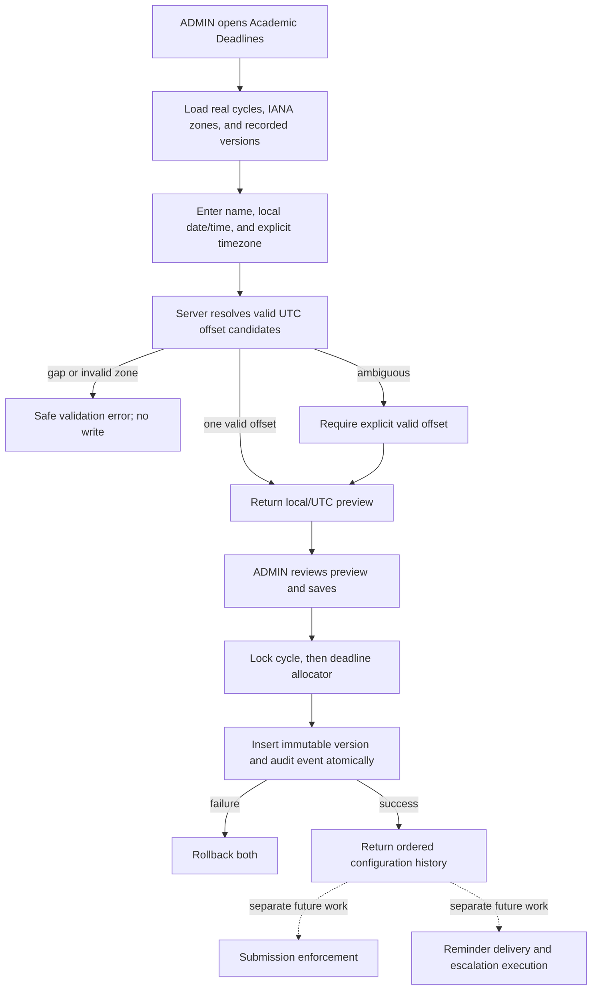

The server uses the installed IANA timezone database. It accepts a local wall time plus an explicit IANA zone, detects daylight-saving gaps and overlaps by round-trip resolution, and requires an offset choice only when more than one instant is valid. The final write includes the server-previewed UTC instant and is rejected if it no longer matches the local time, timezone, and offset. Both write endpoints reject naive timestamps. The runtime must provide IANA timezone data; unavailable data produces a sanitized service error. PostgreSQL stores the canonical instant as timezone-aware data and retains the IANA zone for faithful display.

The latest version means only the most recently recorded configuration. It is not approved, published, active, enforced, or scheduled. The deadline identity remains fixed to its original academic cycle, and earlier versions are never rewritten.

### M1-G.1 manual verification

Use an isolated Admin/test context and administrator-supplied values; do not alter real academic configuration.

1. Sign in as an active persisted `ADMIN` and open **Deadlines**.
2. Filter by a real academic cycle and confirm empty/existing states load correctly.
3. Enter a name, optional description, local date/time, and explicit IANA timezone.
4. Validate the time and review both the resolved local value and canonical UTC value before saving.
5. Change the local time or timezone and confirm the preview is invalidated and saving remains unavailable until revalidation.
6. For an ambiguous local time, select one of the server-returned offsets; confirm a nonexistent local time is rejected.
7. Create an initial configuration, then a subsequent version; confirm the cycle remains fixed and earlier history is unchanged.
8. Confirm no submission action, reminder, delivery schedule, escalation, approval, penalty, or grace-period control is shown.

Reported automated coverage includes authorization, Origin rejection, unknown cycles, strict requests, naive timestamps, timezone conversion/mismatch/gap/overlap behavior, historical preservation, atomic audit rollback, and bounded concurrent allocation: 8 deadline tests and 63 full backend tests. Alembic current/head are `a2b3c4d5e6f7`; schema check, `pip check` passed; frontend lint/build were previously reported as passed. Screenshot evidence shows the server preview converting 20 October 2026, 17:00 Asia/Karachi to 12:00 UTC. Browser preview invalidation, save/version-history interactions, and responsive/mobile visual verification remain pending.

## M1-F.1 internal Evaluation Criteria draft pipeline

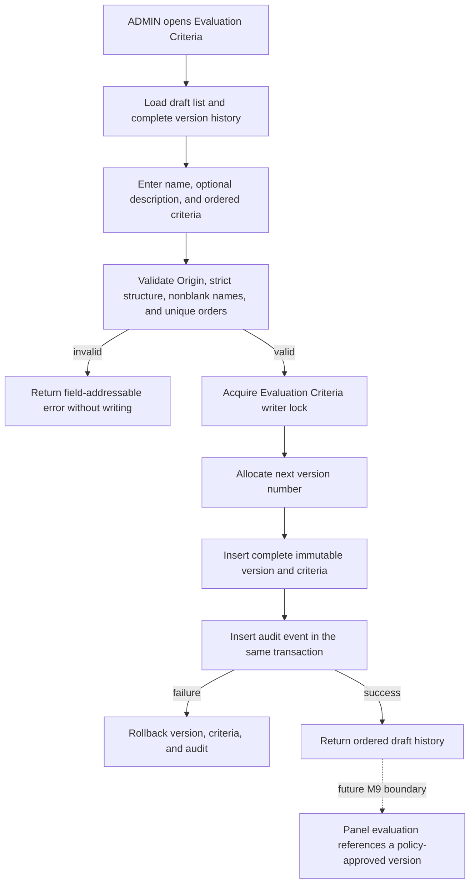

The current screen and API create internal **Draft** configurations only. They do not make Evaluation Criteria approved, published, active, or available to evaluators. They contain no marks, weights, thresholds, evaluation stages, result formula, or score submission. Those values and lifecycle rules must come from authorized university policy rather than software defaults.

### M1-F.1 manual demonstration

Use an isolated Admin/test environment; do not alter real academic records.

1. Sign in with an active persisted `ADMIN` account and open **Evaluation Criteria**.
2. Confirm the empty or existing draft list loads and every configuration is labelled **Draft**.
3. Enter an Evaluation Criteria name, optional description, and at least one criterion. Add, remove, and reorder rows; confirm entered row values move with their rows.
4. Save the initial Evaluation Criteria once and confirm duplicate clicks are disabled while the request is pending.
5. Open its history, change the complete draft, and create the next version.
6. Confirm versions are numbered in order and the earlier version and its criterion order remain unchanged.
7. Confirm validation remains attached to the relevant criterion after row movement and service failures show a safe error.

Automated checks cover authorization, foreign-Origin rejection, validation, ordered history, historical preservation, audit-failure rollback, and concurrent version allocation. The manual browser demonstration and desktop/mobile visual inspection remain pending.

### Remaining M1-F scoring-policy decisions

- Official Evaluation Criteria definitions and criterion wording.
- Permitted marks or scoring scales, weights, total constraints, aggregation, precision, and thresholds.
- Official evaluation-stage names and applicability.
- Draft review, approval, publication, activation, retirement, correction, and version-selection authority.
- Rules connecting a future panel evaluation to an immutable approved Evaluation Criteria version.

## M1-E.1 supervisor capacity pipeline

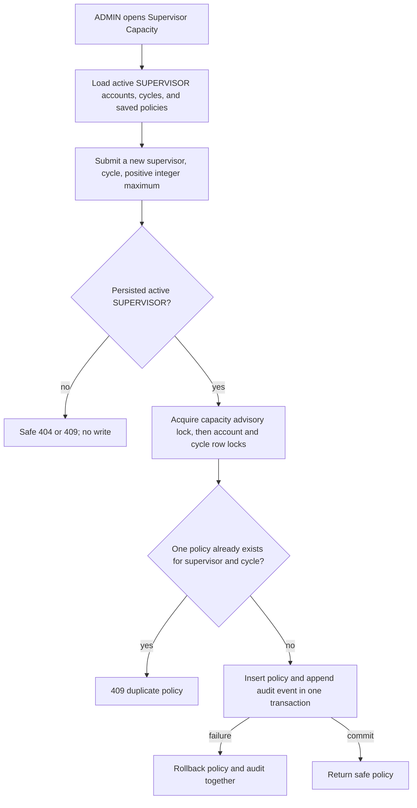

This is configuration, not allocation enforcement. A policy is retained and labelled historical if its supervisor later becomes inactive, but new or edited policies require an active account whose persisted role is `SUPERVISOR`. Verified evidence covers backend tests, migration/schema checks, frontend lint/build, successful policy creation, and edit-form population with separate supervisor name/email fields. Update-save, post-save refresh persistence, and mobile browser verification are pending. ADMIN-only supervisor-to-team assignment now enforces these limits using actual active assignments and displays assigned, remaining and full status. Assignment history is retained. Coordinator permissions and department/cycle scope remain undecided; matching and allocation workflows beyond manual ADMIN assignment remain future work. Browser and mobile checks for allocation remain pending.

### M2 pipeline

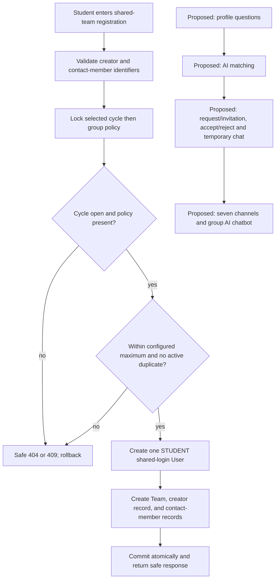

The lower proposed branch is not connected to the current shared-account flow. Its design must decide how requests, invitations, chat authorship, and acceptance work without silently changing the approved shared-login model.

### Approved roster import and registration eligibility

Roster import and eligibility checks for new team registration are implemented. An active persisted ADMIN selects a cycle and uploads an explicitly approved Excel roster. The server previews parsed rows and validates required fields, cycle, semesters 7/8, normalized identifiers and conflicts. The operator explicitly confirms that exact validated preview; the server revalidates against current data and imports the entire batch and a non-sensitive audit event atomically. Coordinator import access is deferred until its department/cycle scope is defined. No external university-system integration is needed.

Roster records are cycle-scoped; group code is recorded as source data, with no unapproved group-composition enforcement. Existing accounts and teams are not automatically verified, deleted, or deactivated. At new team registration, the creator and every contact member must each match registration number and university email on the same approved record for the selected cycle, in addition to existing cycle, size and duplicate checks. A failed check gives a safe field-addressable error and creates no account or team. Shared-team login remains unchanged; member emails are contact identifiers only.

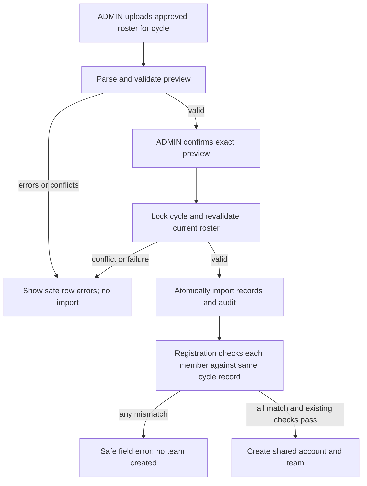

Duplicate or conflicting rows and collisions with existing roster records are rejected for the batch; no silent replacement or partial import. Reimports with existing identifiers require resolution outside this first import path. Confirmation is bound to the exact uploaded bytes, actor and cycle, expires after ten minutes, and is replay-protected; a server restart or another worker invalidates the process-local preview token. Imports lock the cycle consistently with registration, and audit records contain only the cycle and count. How roster corrections, revocations or replacement operate later remains undecided; they are not implied by the initial append-only import proposal.

### M3 pipeline

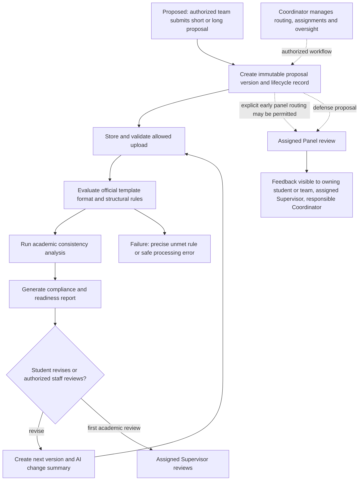

This entire M3 pipeline is proposed only. The assigned Supervisor exclusively owns the first academic review; the Coordinator is not a mandatory reviewer or approver at that stage. Assigned Panel members review defense proposals, and explicit routing may permit panel review before defense. Panel feedback is visible to the owning student/team, assigned Supervisor, and responsible Coordinator. The Coordinator manages workflow, routing, assignments, and oversight without impersonating reviewers, changing authorship, bypassing authorization, or altering immutable history. Panel chat/channels are outside this checkpoint.

Future M1 configuration must supply applicable approved template/rule and workflow settings to M3; M3 must bind proposal versions, assignments, routing and reviewer-authored feedback to the applicable configuration and enforce the decided role boundaries. The current M1 reference records do not constitute approved publication or implement M3 review. Official templates and versioned academic rules, as well as the remaining proposal lifecycle decisions, are prerequisites for complete compliance and review flows.

Still undecided: who may initiate early panel routing, correction/resubmission rules, final approval authority, and Coordinator department/cycle scope. The diagram does not imply an approval chain or resolve those choices.

### Supervisor selection and request workflow (SUPERVISOR-B through SUPERVISOR-E)

The current implementation adds a separate, minimal supervisor-request workflow without claiming final short/long proposal submission. A student selects an open academic cycle and a configured active supervisor, uploads a one-page proposal PDF, reviews the deterministic extraction, confirms it, and submits the request after validation. Requests use explicit `DRAFT`, `SUBMITTED`, `CHANGES_REQUESTED`, `ACCEPTED`, `REJECTED`, and `WITHDRAWN` states with immutable status history, reviewer/comment fields, optimistic revision checks, and append-only audit events. Capacity, active assignment, duplicate, cycle, and team ownership checks are repeated inside locked transactions.

The request draft now begins with exactly one uploaded, readable, one-page PDF. The deterministic local `pypdf` service validates PDF format, size, page count, and text readability, then stores the original bytes as an immutable document version together with extracted text, structured fields, source-page references, runtime, and timestamp. The student reviews and confirms the extracted preview; missing required title or purpose fields are shown as `Not detected in PDF` and block confirmation. No manual title, topic, purpose, or summary entry is used. Replacement uploads create a new immutable document version after `CHANGES_REQUESTED`; the request lifecycle remains separate from extraction status (`PENDING`, `EXTRACTED`, `FAILED`, `CONFIRMED`).

Only the selected Supervisor may accept, reject, or request changes. Acceptance creates the existing team assignment when the request belongs to a team; individual requests consume capacity through the request record. Admin and Coordinator screens are read-only monitors. No role can impersonate another reviewer or silently override a decision. Detailed proposal fields, uploads, AI checks, versioning, and final academic approval remain in their later proposal checkpoints.

## Evidence and manual demonstration steps

Automated evidence is listed per feature in the matrix. The following demonstrations use a deliberately provisioned test Admin and test data only; do not alter `FALL-2026`, Team 81, account 122, demo account 6, or real audit history.

1. Start the backend and frontend using existing local configuration. Sign in with an authorized test Admin account.
2. Open **Users & Roles**. Demonstrate search, role/status filters, pagination, valid account creation, and confirmation before a role/status change. Confirm only safe fields are displayed.
3. Open **Academic Cycles & Policies**. With an isolated test cycle, show code/name, registration state, a positive maximum including the creator, and `Not configured` where no policy exists. Show the safe conflict when opening without a policy.
4. With an isolated team, attempt to reduce the maximum below team size. Confirm the conflict and unchanged policy.
5. Log out and verify the authenticated account view is unavailable.

No screenshots were captured in this checkpoint. Browser verification remains pending until these steps are performed and screenshots are deliberately captured.

## Prioritized remaining checkpoints and blockers

Remaining M1-D decisions: official templates with versioned academic rules

### Observability

Backend responses carry an `X-Request-ID`; the centralized request middleware logs safe JSON start/completion records with method, sanitized path, workflow, status, duration, and failure stage. Authentication diagnostics include only cookie presence/name and session lookup success. Development frontend logs capture workflow, endpoint path, status, request ID, duration, and safe error category; verbose logs are disabled in production. Use the request ID shown in a frontend error or response header to correlate a browser failure with backend logs. Passwords, cookies, tokens, API keys, prompts, proposal text, and uploaded content are never logged.

The implemented administrative reference foundation still requires:

- official blank short- and long-proposal files and an approval authority;
- publication/storage/download and activation/retirement policy and operations;
- approved machine-readable normative rules for future academic workflows;
- browser verification of the existing ADMIN screen.

This implements the M1 template/rules foundation without claiming M3 format checking.

### Questions that block M1-D

1. Provide the official blank short-proposal and long-proposal templates, their file format(s), and the authority that approves a new version.
2. Provide the authoritative formatting specification: fonts/sizes, margins, alignment, spacing, headings, numbering, table/figure rules, required sections/order, references, appendices, and captions. The submitted project proposals do not establish these rules.
3. Decide template version policy: activation/retirement authority, historical-submission linkage, effective dates, and whether one version of each type must be active.
4. Decide whether template files live in application/database storage, approved object storage, or a controlled external repository, including retention and download permissions.

### Subsequent source-dependent decisions

- Define semester/workflow states; review ownership is decided, while the early-routing initiator, correction/resubmission rules, final approval authority, and Coordinator department/cycle scope remain open.
- Provide capacity, Evaluation Criteria/scoring, deadline, reminder, and escalation policies before their M1 checkpoints.
- Resolve shared-login attribution for M2 matching, invitations, requests, chat, and collaboration before building those flows.

### SUPERVISOR-H: decision follow-up, reference search, and authorized conversation

The selected Supervisor remains the only role that can accept, reject, or request changes. The decision endpoint requires the current request revision and a non-empty comment for rejection or requested changes; acceptance rechecks capacity and creates the existing assignment inside the same locked transaction. Admin and Coordinator monitor records and audit history without gaining decision authority. Students can withdraw their own active request and resubmit a replacement PDF only after `CHANGES_REQUESTED`.

Proposal reference search is a separate, authorized read-only service under `/api/v1/proposal-references/search`. It normalizes titles, returns exact-title matches before token-similarity candidates, and explicitly reports `no_close_match` when none is found. Similarity is advisory only: it never blocks submission and does not claim semantic or AI analysis. Reference PDFs are stored in a separate document table and are available only to Student, Supervisor, Coordinator, and Admin roles; Panel Members are denied. Development fixtures are opt-in via `python scripts/seed_proposal_references.py` and are never inserted automatically.

Request conversation is scoped to `/api/v1/supervisor-requests/{request_id}/conversation`. Only the owning Student/team, the selected Supervisor, an authorized Coordinator, or an Admin may read or append messages. Cross-student requests and Panel Members are denied server-side. Messages are append-only, contain no file/token/password data, and write their audit event in the same transaction. Existing team and match-chat channels remain unchanged. Migration `e7f8a9b0c1d2` adds the reference/document and request-message tables with restrictive foreign keys and an append-only database trigger.

### Archive and knowledge search checkpoint

The final FYP archive is a separate logical record set under migrations `f9a0b1c2d3e4` and `fa0b1c2d3e4`; it is not a physical duplicate database and it does not reuse supervisor-request documents. `ArchivedProject` stores searchable metadata independently from `ArchivedProjectDocument`, which stores immutable PDF versions by type: short proposal, long proposal, chapters 1–4, final report, final package, references, and other. Admin uploads create a new version and deactivate only the previous active version; metadata edits recalculate normalized titles and append an audit event. Deactivation is non-destructive, and title/year reuse is allowed only after deactivation.

Students search only active archive records through deterministic ranking: exact title, normalized title, keyword, summary, then scope matches. Results include rank, match reason, summary, year, scope, completion stage, implemented-scope and remaining-gap previews, and active-document count. Semantic ranking is explicitly reported as unavailable because no approved archive embedding source is configured; no fabricated score or AI result is returned. Student detail is read-only and exposes only permitted metadata and secure active PDF links. Supervisors and Coordinators may read authorized active records; Admin is the only writer; Panel access is denied by default.

Development fixtures are opt-in and idempotent: `python scripts/seed_archived_projects.py` creates eight `SAMPLE_DATA` projects with separate short-proposal, long-proposal, and final-report PDFs after a development Admin exists. The seed is never run at application startup or against production automatically.

### Evaluator portal mapping

The existing `PANEL_MEMBER` database role is presented to users as **Evaluator** and routes to `EvaluatorPortal`. There is no separate user-facing Panel Member portal. Evaluator assignment, proposal review, defense scheduling, scoring, feedback, and decision-history APIs are not currently available, so the portal shows safe unavailable states and makes no fabricated requests or results.

### Coordinator/Admin monitoring and request conversations

`/api/v1/supervisor-requests/coordinator/monitor` and `/api/v1/supervisor-requests/admin/monitor` are read-only monitoring surfaces. They support cycle, selected-supervisor, lifecycle-status, and UTC date-range filters and return proposal ownership, extracted fields, original-document references, submission notes, status history, capacity usage/limits, and existing authorized audit detail. Neither role can accept, reject, request changes, or silently alter Supervisor decisions.

Request conversations remain scoped to the request. The owning Student/team and selected Supervisor may append messages; Coordinator and Admin may read within their monitoring policy but receive `403` when attempting to send; Panel/Evaluator and unrelated users remain denied. Messages are chronological, append-only, timestamped with sender identity, and written with their audit event transactionally.

### Coordinator/Admin registry workflow

Coordinator and Admin registry lists are separate role-protected reads under `/api/v1/fyp-registry/{coordinator,admin}`. Filters are applied to cycle, section metadata, supervisor, student activity, proposal status, assignment status, completion availability, dates, and normalized search text. Detail responses assemble only persisted request, team, document, extraction, conversation, status-history, audit, and archive-match values; when no progress model exists they display `Progress tracking is not configured yet.`

Only Admin may update registry metadata (`department_section`, `project_scope`, `team_label`, and administrative notes). Each update requires a correction reason, locks the request, stores a before/after snapshot in `fyp_registry_metadata`, and writes its audit event in the same transaction. Proposal PDFs, extraction snapshots, decisions, credentials, and historical audit records are not editable. Official template ingestion is a reference-baseline workflow: missing proposal-only fields are informational and do not become student-proposal validation failures.
