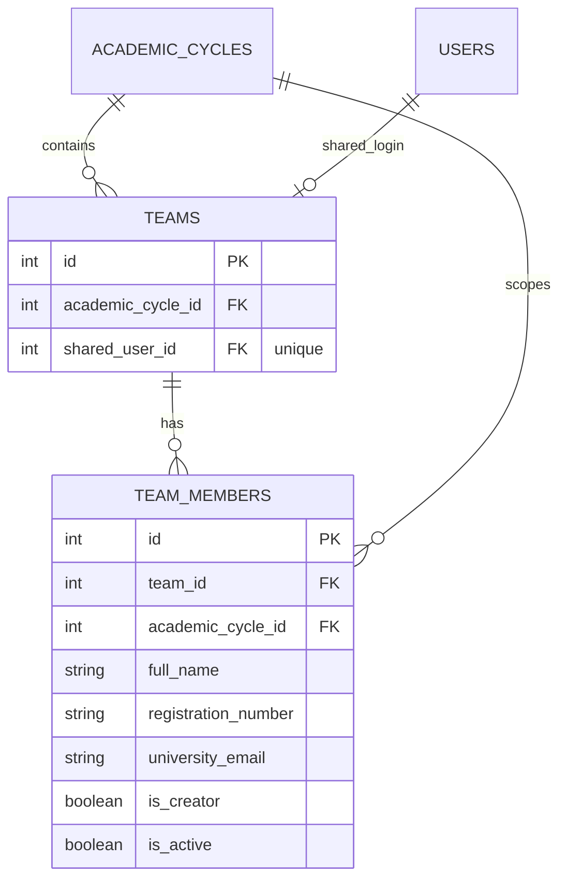

# Team Registration Schema

## Status

The schema foundation is applied through Alembic revision `ce964120f177`. It supports a future atomic shared-team registration service; no team-registration API or frontend integration exists yet.

## Tables and relationships

- `teams` stores one team for an academic cycle and links it to one shared `users` account through `shared_user_id`.
- `team_members` stores the creator and the additional contact records for a team. Member university email addresses are contact identifiers, not login accounts.
- Each team member carries `academic_cycle_id`; the composite foreign key to `teams(id, academic_cycle_id)` requires it to match the team's cycle.



## Applied database constraints

- `teams.shared_user_id` is unique: a shared login user cannot belong to two teams.
- `(teams.id, teams.academic_cycle_id)` is unique and is referenced by `team_members`, preventing a member from using a cycle different from its team.
- `(team_members.team_id, registration_number)` is unique.
- Active member registration numbers are unique within an academic cycle.
- Active member university contact emails are unique within an academic cycle.
- `full_name` must be trimmed and nonblank; names are not otherwise unique.
- Registration numbers must be trimmed, nonblank, and stored uppercase. University contact emails must be trimmed, nonblank, and stored lowercase.
- A partial unique index permits at most one `is_creator = true` member per team.

The database enforces *at most* one creator. Inserting exactly one creator, and ensuring that its name/registration number is consistent with the linked shared `User`, remain responsibilities of the future atomic registration service.

## Verified tests

The database target was confirmed as `fyphub_p1`. The complete test suite passed: 15 tests total (9 team/member constraint tests and 6 existing registration tests). The team/member tests cover duplicate registrations within a team and active cycle, duplicate active contact email, noncanonical values, same-name students with distinct identifiers, cycle mismatch, a second creator, duplicate shared-user linkage, and identifier reuse in another academic cycle.

Run the tests from the `backend` working directory:

```powershell
& '.\.venv\Scripts\python.exe' -m unittest discover -s tests -p 'test_*.py' -v
```

All test writes run in an outer transaction and are rolled back. Post-test verification found no retained test cycle, user, or member records.

## Remaining work

- Implement the atomic team-registration API with the configured cycle/policy checks.
- Enforce exactly one creator and creator/User consistency in that service.
- Integrate field-level validation and submission with the existing frontend.
