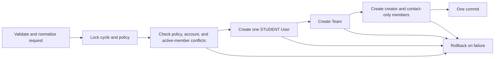
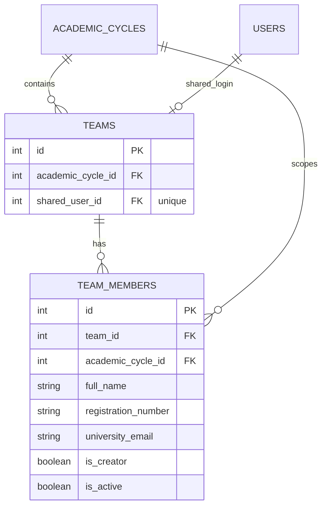

# Team Registration Schema

## Status

The schema foundation is applied through Alembic revision `ce964120f177`. The backend now provides atomic shared-team registration; frontend integration is still pending.

## API contract

`POST /api/v1/team-registration` accepts a strict JSON body with `academic_cycle_id`, `creator`, `shared_login_email`, `password`, and additional `members`. The creator is not repeated in `members`. Unknown fields, including role, account IDs, and `is_active`, are rejected.

- The endpoint normalizes names by trimming, registration numbers by trimming and uppercasing, and email addresses by trimming and lowercasing. Passwords are passed unmodified to Argon2id.
- The selected cycle must exist and have `registration_open = true`; its actual group policy must exist. The creator counts toward `max_group_size`; no minimum or default size is invented.
- It rejects request-level duplicate registrations/contact emails, existing active member conflicts in the selected cycle, and existing shared-login email or creator-registration `User` records.
- HTTP `201` returns safe account, team, cycle, and member fields only. It never returns a password or password hash, and no token is issued.
- Domain errors use a safe `detail` object with a stable `code`, user-safe `message`, and `field` path where known. Examples include `academic_cycle_not_found` (`404`), `academic_cycle_closed`, `academic_group_policy_missing`, and duplicate conflicts (`409`). Request-shape validation returns `422` with `invalid_request` and field paths; domain input and group-size errors return their own stable `422` codes.

Example success shape (identifiers shown as placeholders):

```json
{
  "account": {"id": 42, "full_name": "Creator", "email": "team@example.edu", "registration_number": "REG-001", "role": "STUDENT", "is_active": true, "created_at": "..."},
  "team": {"id": 18, "academic_cycle_id": 7, "created_at": "..."},
  "cycle": {"id": 7, "code": "P1-2026", "display_name": "P1 2026"},
  "members": [{"id": 91, "full_name": "Creator", "registration_number": "REG-001", "university_email": "creator@example.edu", "is_creator": true, "is_active": true, "created_at": "..."}]
}
```

## Transaction behavior



Additional members create only `team_members` records; they do not create `users` accounts. Existing accounts are never adopted or modified by this endpoint.

## Tables and relationships

- `teams` stores one team for an academic cycle and links it to one shared `users` account through `shared_user_id`.
- `team_members` stores the creator and the additional contact records for a team. Member university email addresses are contact identifiers, not login accounts.
- Each team member carries `academic_cycle_id`; the composite foreign key to `teams(id, academic_cycle_id)` requires it to match the team's cycle.



## Applied database constraints

- `teams.shared_user_id` is unique: a shared login user cannot belong to two teams.
- `(teams.id, teams.academic_cycle_id)` is unique and is referenced by `team_members`, preventing a member from using a cycle different from its team.
- `(team_members.team_id, registration_number)` is unique.
- Active member registration numbers are unique within an academic cycle.
- Active member university contact emails are unique within an academic cycle.
- `full_name` must be trimmed and nonblank; names are not otherwise unique.
- Registration numbers must be trimmed, nonblank, and stored uppercase. University contact emails must be trimmed, nonblank, and stored lowercase.
- A partial unique index permits at most one `is_creator = true` member per team.

The database enforces *at most* one creator. Inserting exactly one creator, and ensuring that its name/registration number is consistent with the linked shared `User`, are service responsibilities rather than standalone database constraints. The registration endpoint performs both for public creation; direct database writes must not bypass that service.

## Verified tests

The database target was confirmed as `fyphub_p1`. The complete test suite passed: 23 tests total (8 team-registration API tests, 9 team/member constraint tests, and 6 existing registration tests). API tests cover successful creation and Argon2id hashing, exactly one user/creator, unknown/closed/missing-policy cycles, configured maximum/excess size, request/existing-record conflicts, individual-account creator conflicts, invalid/privileged fields, forced late member-insert rollback, and safe responses. The constraint tests cover duplicate registrations within a team and active cycle, duplicate active contact email, noncanonical values, same-name students with distinct identifiers, cycle mismatch, a second creator, duplicate shared-user linkage, and identifier reuse in another academic cycle.

Run the tests from the `backend` working directory:

```powershell
& '.\.venv\Scripts\python.exe' -m unittest discover -s tests -p 'test_*.py' -v
```

All test writes run in an outer transaction and are rolled back. Post-test verification found no retained test cycle, user, or member records.

## Remaining work

- Integrate field-level validation and submission with the existing frontend.
- Add authenticated Admin configuration for cycles and group policies; no real cycle or policy data has been seeded.
- Implement sign-in, sessions, and authorization. Shared-account use limits attribution to the shared team account.
