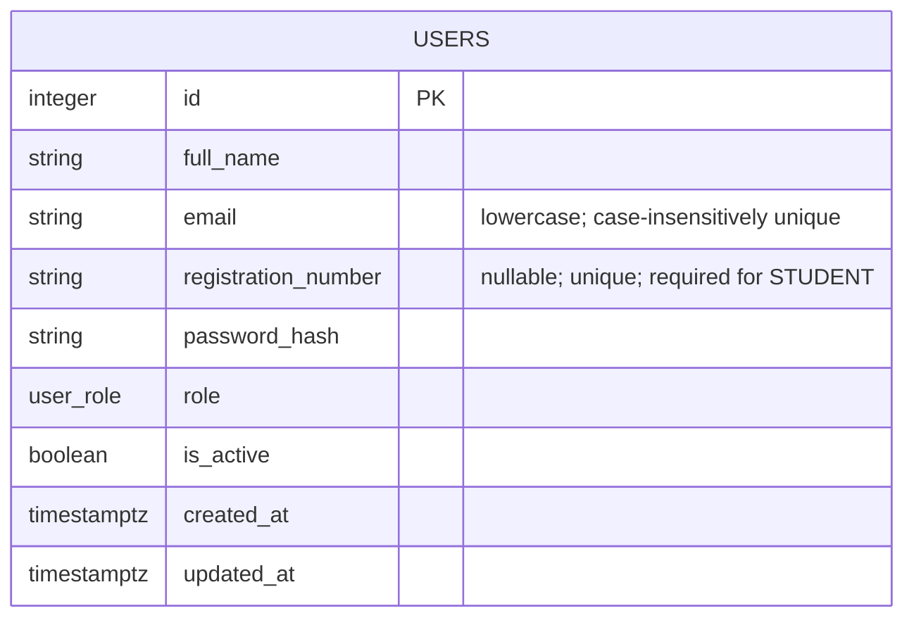

# Users and Roles Foundation

## Users table

The `users` table is the database foundation for future authentication and role-aware features. No accounts or authentication endpoints are created in this checkpoint.

| Field | Purpose |
| --- | --- |
| `id` | Primary key. |
| `full_name` | Required name shown for the user. |
| `email` | Required login/contact identifier. It is trimmed and stored in lowercase; the database enforces a case-insensitive unique index. |
| `registration_number` | Student identifier. It is trimmed and stored in uppercase, unique when present, and required for `STUDENT`. |
| `password_hash` | Required password-hash storage field. Plaintext passwords must never be stored. |
| `role` | One of the five database-enforced roles. |
| `is_active` | Required account-availability flag, defaulting to `true`. |
| `created_at` | Timezone-aware record creation timestamp. |
| `updated_at` | Timezone-aware timestamp maintained by future ORM updates. |

## Roles

- `STUDENT` — a project student; requires a registration number.
- `SUPERVISOR` — an academic supervisor.
- `COORDINATOR` — a programme or project coordinator.
- `PANEL_MEMBER` — a member of a review or evaluation panel.
- `ADMIN` — an administrative user.

Students are identified by their required registration number. Staff roles are created through a future controlled staff-creation workflow and therefore may have no registration number. This checkpoint does not create that workflow or any accounts.

## Normalization convention

Future APIs and import jobs must normalize email as `strip().lower()` and registration number as `strip().upper()` before persistence. The model applies this convention and database checks reject non-canonical stored values. Registration number uniqueness permits multiple `NULL` values for staff users.

## Verification and remaining work

Migration `9c227dc337bf` created only the `users` table, its constraints/indexes, and the `user_role` enum. Alembic current matches head and a second autogenerate check found no pending changes. The table currently contains zero rows, and pgvector remains installed at version `0.8.6`.

Public student registration now creates only `STUDENT` records, normalizes the supported identifiers, and stores Argon2id password hashes only. Remaining work includes sign-in, authorization enforcement, controlled staff creation, token/session handling, password recovery, and frontend screens.
